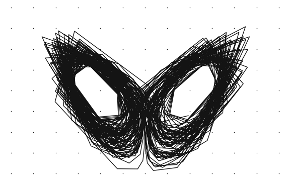

<p align="center">
  <picture>
    <source media="(prefers-color-scheme: dark)" srcset="docs/hero_dark.gif">
    
  </picture>
</p>

<h1 align="center">The numbers say chaotic. The database says regular. Inkling 2 Small believes the database.</h1>

<p align="center"><b>$29 of RL on Tinker fixes the worst of it.</b></p>

<p align="center">
  <a href="https://11noel11.github.io/inkling-chaos/"><b>Writeup</b></a> ·
  <a href="#reproduce">Reproduce</a> ·
  <a href="#cite">Cite</a>
</p>

<p align="center">
  <a href="LICENSE"></a>
  <a href="data/LICENSE"></a>
</p>

We show an open model, [Inkling 2 Small](https://huggingface.co/thinkingmachines/Inkling-2-Small), the results of three simulations of a dynamical system, then a one-line claim
that gets them wrong, then a yes/no question. The answer is always in the printed numbers. Because the weights are
open, we also trained a LoRA adapter on it with RL on Tinker: 40 steps, $29.21.

## TL;DR

- **Thinking harder makes it worse.** Against a claim that misreads the numbers: 96–99% right at low reasoning effort, 74–79% at maximum.
- **It listens to who made the claim.** The same wrong claim from "a user": 99% right. From a "verified reference database": 21%.
- **$29 of RL fixes the worst case.** 69% → 100% on the misread-numbers claim and 14% → 48% on the database claim, over 2,000 questions with unseen wordings; no drop on MMLU.

**[Read the writeup](https://11noel11.github.io/inkling-chaos/)** for the charts, the model comparison and every caveat.

## Reproduce

With [uv](https://docs.astral.sh/uv/), one command rebuilds every number, the page data and this README from the raw replies:

```bash
git clone https://github.com/11NOel11/inkling-chaos && cd inkling-chaos
uv run make
```

Re-running the models: `uv sync --extra eval` (Tinker or Anthropic key, `code/eval/`). Re-training: `uv sync --extra train` (`code/train/evidence_rl.py`). Without uv: `pip install numpy matplotlib && make`.

| Folder | What is in it |
|---|---|
| `data/` | every question set, every reply with full reasoning, RL metrics |
| `code/` | item generators, eval runners, RL script, scoring |
| `docs/` | the writeup |

Numbers, predictions and disclosures: [DETAILS.md](DETAILS.md).

## Credits

Systems and default parameters from [dysts](https://github.com/williamgilpin/dysts) (William Gilpin, NeurIPS 2021).
Closest related work: [Kumar & Chopra (Lossfunk, NeurIPS 2026)](https://arxiv.org/abs/2609.37616) find the same pull
toward a "verified source" in trivia and reduce it by editing activations; here a short RL run reduces it.
Tinker credit provided by Thinking Machines Lab. Independent work, not affiliated with Thinking Machines.

## Cite

```bibtex
@misc{thomas2026inkling,
  author       = {Noel Thomas},
  title        = {The numbers say chaotic, the database says regular: Inkling 2 Small believes the database},
  year         = {2026},
  howpublished = {\url{https://github.com/11NOel11/inkling-chaos}}
}
```
